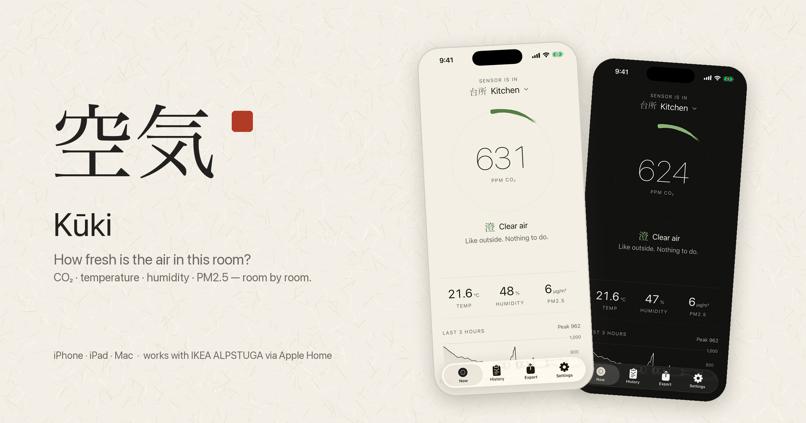
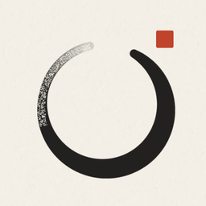
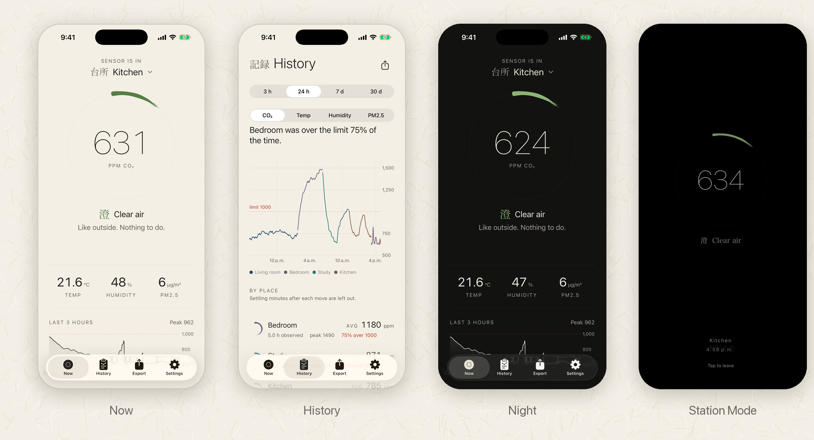
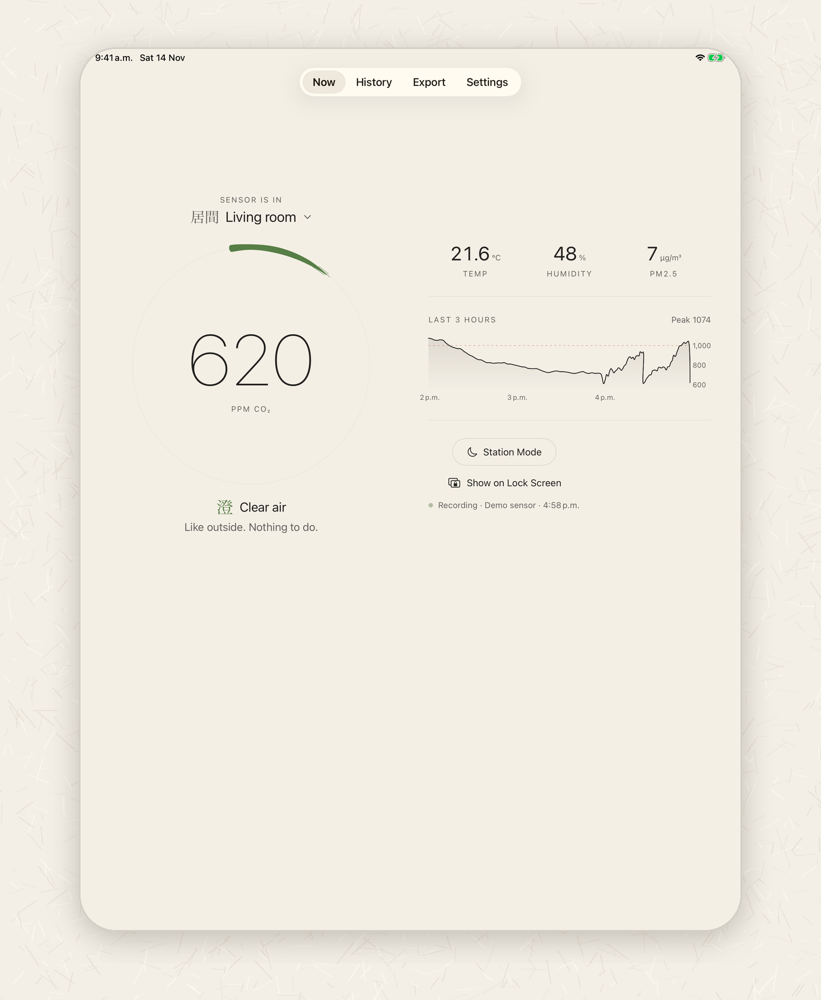

<p align="center">
  
</p>

<p align="center">
  <br>
  <b>空気 · Kūki</b> — <i>how fresh is the air in this room?</i><br>
  <sub>iPhone · iPad · Mac &nbsp;·&nbsp; SwiftUI &nbsp;·&nbsp; Apple Home (HomeKit) &nbsp;·&nbsp; works with the IKEA ALPSTUGA</sub>
</p>

<p align="center">
  <a href="https://apps.apple.com/app/id6834891785"></a>
  <a href="LICENSE"></a>
  
  <a href="https://kuki-co2.pages.dev"></a>
</p>

<p align="center"><b>Open source</b> — the whole app, widgets, Live Activity and Mac menu bar plug-in, under the MIT license. <a href="https://apps.apple.com/app/id6834891785">Get it on the App Store</a> or build it yourself.</p>

---

Kūki reads an air-quality sensor from **Apple Home** and shows the one thing that matters most indoors, **CO₂**, as an *ensō* (円相), the single brush-stroke circle of Zen calligraphy. Clear air is a short stroke; stale air closes the circle. Carry the sensor from room to room and Kūki keeps a history **per place**, so you can see which room needs a window open, and when.

<p align="center">
  
</p>

## What it does

| | |
|---|---|
| **Now** | CO₂ in the ensō, with plain advice: *Clear air* · *Fine* · *Getting stale* · *Stuffy*. Temperature, humidity and PM2.5 underneath, plus the last three hours. |
| **Places** | Tell Kūki where the sensor is: *居間 Living room*, *寝室 Bedroom*, your own. After a move, the first minutes count as *settling* (the CO₂ cell needs time to adapt) and are left out of comparisons. |
| **History** | 3 h · 24 h · 7 d · 30 d for CO₂, temperature, humidity or PM2.5. A one-line takeaway (*"Bedroom was over the limit 75% of the time"*), averages, peaks, and time over your limit for each place. Gaps where nothing was recorded are drawn as *no data*. |
| **Fūrin alert** | A soft, synthesised wind-bell (風鈴) and a notification when CO₂ crosses your limit (1000 ppm by default). It rings once per stuffy spell, not every minute. |
| **Station Mode** | A dim, always-awake screen for a device left on a charger. It keeps Kūki in front, so it keeps recording. |
| **Widgets & Live Activity** | Home Screen, Lock Screen, Dynamic Island and StandBy. They fade honestly when the reading is old. |
| **Mac** | Runs from the **menu bar** and keeps recording 24/7, window open or not. Show CO₂, temperature, humidity or PM2.5 next to the clock; *Move Sensor To*, Station Mode, Settings, *Open at Login*. |
| **Export** | CSV for spreadsheets, or a Markdown brief made to paste into **Claude or ChatGPT**: context, a summary per place, and the data averaged to fit a chat. |
| **iCloud (optional)** | Through your private iCloud: each device's history, your places and which room the sensor is in sync between your devices, and the latest reading reaches your other devices' widgets, Lock Screen and alerts. |

<p align="center">
  <br>
  <sub>The wide layout used on iPad and Mac.</sub>
</p>

## How it works

```
IKEA ALPSTUGA ──Thread──▶ Apple Home ──HomeKit──▶ Kūki (in front) ──▶ history on this device
   (Matter)            (HomePod / Apple TV /           │
                         router / iPhone)              └─ latest reading ──iCloud──▶ widgets · Live Activity · alerts
```

- **Apple Home is the bridge.** The ALPSTUGA speaks Matter over Thread. Once it's in the Home app, Kūki reads it through HomeKit. No IKEA hub or cloud is needed.
- **Apple Home only talks to an app that's active.** On the **Mac**, Kūki runs as a menu bar app with a tiny invisible window, so macOS keeps it active and it **records around the clock**, even with its window closed (turn on *Show in Dock* and it becomes a normal app that pauses in the background). On **iPhone and iPad**, Kūki records while it's open; leave a spare device in **Station Mode** for continuous data. When Kūki can't hear the sensor it says why ("Paused") rather than pretending the sensor vanished.
- **Honest values.** Every metric carries the time Apple Home last really reported it. Old values are never recorded or alerted on, and after a return Kūki shows *"Reaching your sensor…"* while Apple Home reconnects (usually 5–15 s).

## Design

Washi paper and sumi ink, with three natural pigments that carry meaning, and only meaning:

| | Pigment | Means |
|---|---|---|
| 🟩 | **matcha** 抹茶 | clear air |
| 🟨 | **kincha** 金茶 | getting stale |
| 🟥 | **shu** 朱 | act now (and the limit line) |

The ensō is drawn as a real brush: a heavier press where it lands and a tail that thins into dry-brush streaks (*kasure*, 掠れ). Moving the sensor repaints it, Kūki's one orchestrated moment, with a soft haptic as the brush lands. Everything honours **Reduce Motion**, **Increase Contrast**, **Bold Text** and **Dynamic Type**, and every chart has a VoiceOver summary and Audio Graph.

## Build

Requirements: **Xcode 27**, iOS 18 / macOS 15 or later, an Apple Developer team (HomeKit, App Groups and iCloud need a signed build).

```bash
git clone https://github.com/LubomirOlshansky/Kuki.git
open Kuki/Kuki.xcodeproj
```

Choose **My Mac (Mac Catalyst)** or your iPhone and press Run. The first launch opens a short introduction; Kūki asks for access to your Home only when you choose **Connect Apple Home** there (or turn the demo sensor off).

No sensor? Turn on **Settings › Demo sensor**. In Debug builds you can also launch with demo history:

```bash
xcrun simctl launch booted com.olshanskysoft.kuki -useDemo YES -seedDemoOnLaunch YES
```

Debug builds can show the introduction again (it doesn't reset the Home or notification permission; reinstall for that), or open it at one screen:

```bash
xcrun simctl launch booted com.olshanskysoft.kuki -resetOnboarding YES
xcrun simctl launch booted com.olshanskysoft.kuki -resetOnboarding YES -onboardingStep night
```

Steps: `welcome questions breath night listen appleHome place furin plan`. Settings › Replay introduction shows it in any build.

Tests (Swift Testing, 197 tests):

```bash
xcodebuild test -project Kuki.xcodeproj -scheme Kuki -destination 'platform=iOS Simulator,name=iPhone 17 Pro'
```

### Project layout

```
Kuki/          the app: views, HomeKit source, recorder, export, bridges, Sync/ (history sync, CKSyncEngine)
Shared/        compiled into the app and the widget: palette, ensō, CO₂ levels, iCloud sync
KukiWidget/    widgets and the Live Activity
KukiMenuBar/   a small AppKit bundle the Mac app loads for its menu bar item
KukiTests/     unit tests
docs/          App Store guide, images
```

The Mac app is **Mac Catalyst**, because HomeKit on the Mac exists only for Catalyst apps. Catalyst can't create a menu bar item, so a tiny AppKit plug-in does it, driven through an `@objc` protocol.

## Privacy

No account, no ads, no tracking. Readings stay on your devices. iCloud Sync, if on, keeps your history, places and latest reading in **your** private iCloud.

Kūki sends **usage statistics** to [Amplitude](https://amplitude.com) (EU data centre), tied to a random device identifier: which features are used, device and OS, app version and approximate location from the IP address. No account, and not used for tracking. Never readings, never place, room, sensor or home names. Users can turn it off in Settings › Privacy › *Share usage data*. See [PRIVACY.md](PRIVACY.md).

Builds made from a fork send nothing: `Kuki/Analytics/AnalyticsConfig.swift` only starts the SDK under the bundle ID `com.olshanskysoft.kuki`, and never under XCTest. Debug builds report to the "Kūki DEV" project, Release builds to "Kūki PROD". The event catalogue lives in `Kuki/Analytics/`.

## Releasing

Step-by-step App Store guide: [docs/APP_STORE.md](docs/APP_STORE.md).

## Contributing

Issues and pull requests are welcome: bug reports, sensor compatibility notes, translations, ideas. Please run the tests before opening a pull request. Analytics only starts for the official bundle ID, so builds you make under your own ID send nothing.

## License

Kūki is open source under the [MIT license](LICENSE). Copyright © 2026 Lubomir Olshansky.

The license covers the code. The Kūki name, icon and App Store listing are not licensed for reuse: if you publish your own build, give it a different name and icon.

---

<sub>Kūki is an independent app and is not affiliated with IKEA. ALPSTUGA is a trademark of Inter IKEA Systems B.V. Apple, HomeKit, iPhone, iPad and Mac are trademarks of Apple Inc.</sub>
